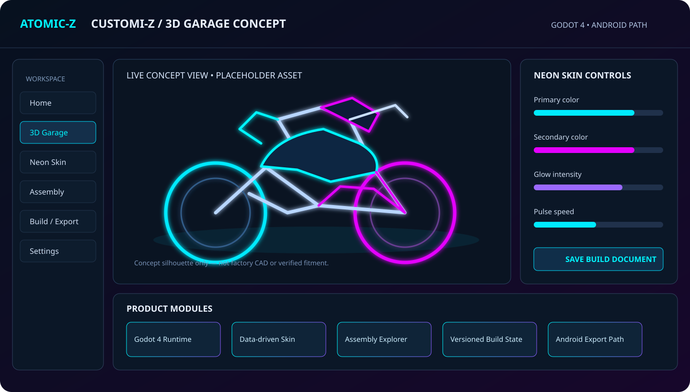

🌐Project;

💠🔷🔹Customi-Z🔹🔷💠
(Customized)

Unified To Customizing Series Of Product For; 

🔳◻️◽▫️▪️Customization Workbench▪️▫️◽◻️🔳

FOR;
🏍️Motorcycle 
🏎️Machine (Car)
✈️Airplane (Aerospace)
🌐And More.... .

One Android-first application.
One vehicle/build context.
One canonical data contract.
Internally modular,externally one continuous product.

This Season Of this production,We build An;
Is a 3D motorcycle garage and customization workbench for vehicle inspection, Stock/Exploded assembly, part/material editing, neon and graphic design, persistence and export. Godot 4 / GDScript is the only product runtime and Android delivery engine.

**Asset honesty:** current motorcycle geometry is procedural placeholder geometry, not Kawasaki factory CAD, not a verified ZX-25RR replica and not an engineering-validated model.

## Product concept illustration

This is the only visual concept asset currently verified in the repository. It illustrates a proposed product interface and placeholder motorcycle silhouette; it is not a runtime screenshot, a factory motorcycle render, or evidence of implemented UI fidelity. No additional image files from the current chat were available to transfer. Runtime and target-device screenshots remain pending.

See the [Visual Asset Register](docs/VISUAL_ASSET_REGISTER.md) for the verified image inventory and evidence labels.

## The integrated experience

- Vehicle identity and variant selection.
- Named part assembly with Stock / Exploded views.
- Orbit camera, touch/mouse input and adaptive rendering.
- Stable part selection and isolated per-part paint/material editing.
- Neon/graphic layers in the same garage HUD and 3D scene.
- One saved build state with validated temp/backup recovery and one export pipeline.
- Future asset catalog, parametric geometry, engineering checks and calibrated hardware adapters.

These are integrated capabilities of one application, not separate products or standalone subprojects.

## Run

1. Install the supported Godot 4 editor.
2. Clone this repository.
3. Import the folder containing project.godot.
4. Run the project from the editor.

## Android

An Android arm64 debug export preset and CI export job are present. A CI-generated APK is not equivalent to installation and validation on the target Redmi device. Physical-device acceptance remains separate.

## Verification

Run the current headless checks from the repository root:

    godot --headless --editor --path . --quit
    godot --headless --path . --script res://tests/smoke_test.gd
    godot --headless --path . --script res://tests/neon_skin_test.gd
    godot --headless --path . --script res://tests/build_document_test.gd
    godot --headless --path . --script res://tests/surface_material_binder_test.gd
    godot --headless --path . --script res://tests/build_document_ui_state_test.gd
    python -m unittest discover -s tests -p "test_*.py" -v

The Python tests currently cover the legacy desktop authoring/preview utility. That utility is a development aid and compatibility path, not a separate product experience. Product customization must converge into the Godot runtime and canonical BuildDocument.

## Architecture and governance

Read these before changing code:
- [AGENTS.md](AGENTS.md) — mandatory rules for every coding model/agent.
- [Context Integrity Protocol](docs/CONTEXT_INTEGRITY_PROTOCOL.md) — project identity, evidence hierarchy, contamination recovery and context classification.
- [Unified System Specification](docs/UNIFIED_SYSTEM_SPEC.md) — product and system contract.
- [Agent Governance](docs/AGENT_GOVERNANCE.md) — concurrent agent/branch/PR policy.
- [Roadmap](docs/ROADMAP.md) — end-to-end phases and exit gates.
- [Godot Motorcycle Rendering Research](docs/GODOT_MOTORCYCLE_RENDERING_RESEARCH.md) — GLB surface binding, PBR material ownership and mobile rendering guidance.
- [Research and Decisions](docs/RESEARCH_AND_DECISIONS.md) — GitHub, Build Your Own X, Nature research and ADRs.
- [Research Vault](research/README.md) — pinned external source revisions, reverse-engineering dossiers, licence/provenance gates and sparse source retrieval.
- [Architecture](docs/architecture.md) — technical architecture.
- [Acceptance](docs/acceptance.md) — testable acceptance gates.
- [Project Context Brief](docs/project-context-brief.md) — reconciled project context and current work sequence.
- [Visual Asset Register](docs/VISUAL_ASSET_REGISTER.md) — image inventory, provenance and screenshot status.

## Project charter, philosophy & handoff

- [Project Charter](docs/PROJECT_CHARTER.md) — mission, scope, success criteria and governance.
- [Manifesto & Philosophy](docs/MANIFESTO.md) — principles, product promise and creative philosophy.
- [Product Catalog](docs/PRODUCT_CATALOG.md) — current capabilities versus roadmap; no overclaiming.
- [Development Workflow](docs/DEVELOPMENT_WORKFLOW.md) — branch/PR flow, quality gates and debugging protocol.
- [Product Handoff Presentation](docs/HANDOFF_PRESENTATION.md) — presentation-ready 10-slide handoff outline.
- [Repository Audit & Work Report](docs/PROJECT_AUDIT_REPORT.md) — inspected files, gaps, work performed and validation status.

## Technology boundary

Godot owns the product scene, UI, input, materials, effects, persistence and Android export. Blender to GLB/glTF 2.0 to validation to Godot is the preferred asset path. Python/Tkinter and ModernGL are reference/developer tools; useful controls and rendering ideas are ported into Godot, not shipped as parallel product runtimes.

## Vehicle identity

The accepted base vehicle in project decisions is Kawasaki Ninja ZX-25RR. The initial neon document explicitly says ZX-25R. Do not treat these as identical for geometry, parts or fitment until exact year/market/variant evidence resolves the difference.

## Status vocabulary

Use PASS / FAIL / NOT RUN / BLOCKED. Code presence or a green headless test is not proof of Android device performance, factory geometry, fitment or engineering validity.

## Continue in a new chat or with another contributor

The project is intentionally independent of any single chat or AI session. The repository is the durable source of truth; conversation history is optional context only.

**Start here:** [Canonical Project Status / Resume Checkpoint](docs/PROJECT_STATUS.md).

For a clean handoff, clone the repository and read `AGENTS.md`, then `docs/PROJECT_STATUS.md`, then the linked canonical specifications. Re-check live GitHub state before acting because the checkpoint is timestamped. At the end of each task, update the checkpoint through a reviewed PR.
