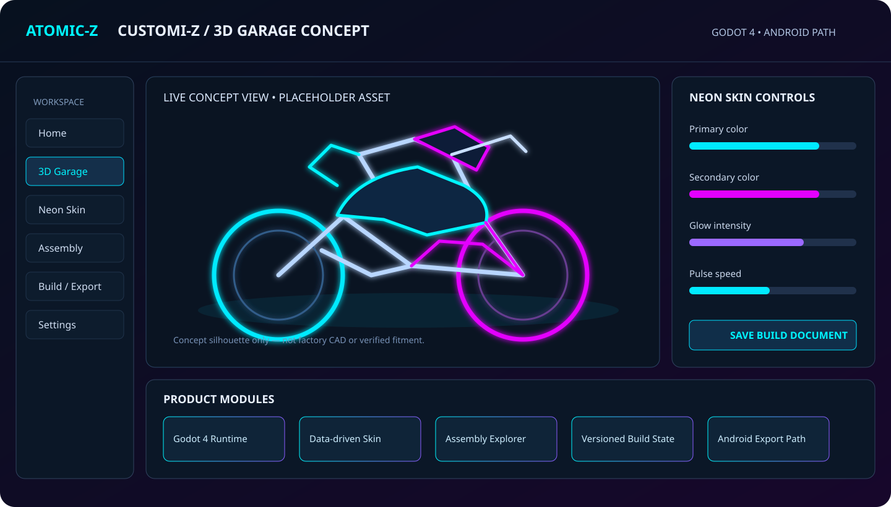

# Atomic-Z-Customi-Z — Project Charter

**Version:** 1.0 | **Status:** Charter baseline | **Product runtime:** Godot 4 | **Target:** Desktop development and Android delivery

## 1. Purpose
Atomic-Z-Customi-Z is a data-driven motorcycle customization workbench and virtual garage. The accepted target identity is Kawasaki Ninja ZX-25RR; exact model year, market, variant and geometry compatibility remain evidence-gated. It prioritizes an approachable 3D garage, neon and graphic design, part-level assembly exploration, portable build documents, and a disciplined path toward Android.

### Product concept visual

This authored vector is a product/UI concept illustration with placeholder motorcycle geometry. It is not a runtime screenshot, factory CAD, verified ZX-25RR replica or engineering validation. See the [Visual Asset Register](VISUAL_ASSET_REGISTER.md) for provenance and current visual evidence status.

## 2. Vision
Make motorcycle customization expressive, inspectable, and reproducible: a user can create a visual build, save it as a versioned document, reopen it, and share a presentation-ready configuration.

## 3. Scope
### In scope
- Godot 4 as the single product runtime.
- Responsive garage HUD and camera interaction.
- Modular motorcycle placeholder assembly with explicit concept status.
- Data-driven neon segments, palette, glow controls, and BuildDocument-backed persistence.
- Versioned BuildDocument and migration path from legacy neon skin JSON.
- Quality tiers, measurable performance targets, automated validation, CI.
- Documentation: charter, architecture, workflows, catalog, handoff, manifesto, reports.
- Android packaging path and device validation plan.

### Out of scope until evidence/approval
- Claiming factory CAD fidelity or engineering validation.
- Claiming Kawasaki endorsement, licensed assets, or exact fitment.
- Hardware LED deployment without measured segment mapping, electrical design review, and calibration.
- Python/ModernGL as a second runtime for the product.
- Publishing Android builds as production-ready without device testing.

## 4. Principles
1. **One runtime:** Godot owns product UX, rendering, and delivery.
2. **One source of truth:** all editable state belongs to a versioned BuildDocument/state model.
3. **Data before duplication:** configuration and stable IDs drive UI, visuals, save, and export.
4. **Safe by default:** validate ranges, reject malformed values, and do not imply hardware safety.
5. **Evidence over claims:** label concept assets and report tests only when actually run.
6. **Small, reviewable changes:** branch, lint/test, review, merge; no unverified direct production changes.
7. **Accessibility and performance:** quality tiers, reduced motion options, touch-friendly controls.
8. **Traceability:** decisions, asset provenance, requirements, and tests are documented.

## 5. Users and stakeholders
- Primary: motorcycle enthusiasts designing visual skins.
- Secondary: developers extending Godot scenes, data schemas, and exporters.
- Reviewers: maintainers validating assets, workflow, and release quality.

## 6. Success criteria
- Fresh clone imports and opens in the declared Godot version.
- Config validation and save/load round-trip tests pass.
- Stable segment IDs are shared by UI, renderer, and document.
- CI runs static checks and automated tests reproducibly.
- Android export preset is documented; device QA is recorded separately.
- Product screens and docs consistently disclose placeholder / non-CAD status.

## 7. Risks and controls
| Risk | Control |
|---|---|
| Placeholder geometry mistaken for real ZX-25RR CAD | persistent concept disclaimer, asset provenance gate |
| Schema drift between skin and project state | canonical versioned BuildDocument, migrations, round-trip tests |
| Performance regressions on mobile | tiered settings, benchmark protocol, device matrix |
| LED export misunderstood as installation-ready | calibrated profile gate and explicit safety disclaimer |
| Unreviewed changes destabilize main | feature branches, CI, PR review |

## 8. Governance
Changes must follow AGENTS.md, docs/AGENT_GOVERNANCE.md, and the workflow in docs/DEVELOPMENT_WORKFLOW.md. A release requires passing CI, reviewed change log, validated documents, and a truthful readiness statement.
